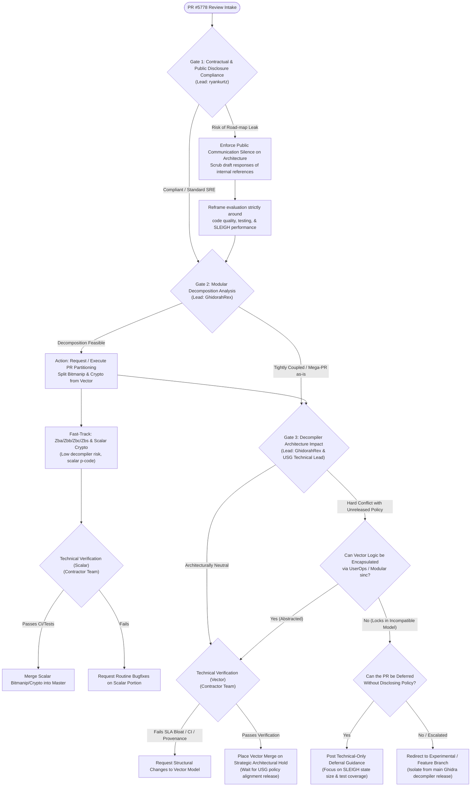

# Review Decision Tree: Ghidra PR #5778 (RISC-V 64 Extensions)

**Target PR:** [NationalSecurityAgency/ghidra#5778](https://github.com/NationalSecurityAgency/ghidra/pull/5778)
**PR Scope:** RISC-V 64 SLEIGH updates for Vector (`V`), Bit Manipulation (`Zba`, `Zbb`, `Zbc`, `Zbs`), and Cryptographic (`Zbk*`) extensions (~6,600+ LOC).
**Primary Reviewer (NSA / Core):** `GhidorahRex`
**Contracted Developer Lead:** `ryankurtz`
**Operational Constraints:**
1. Contractual compliance under USG prepublication/public release restrictions (no disclosure of unreleased internal government roadmaps/policy).
2. Deep decompiler architectural implications (vector dynamic sizing vs. static p-code representations).
3. Maintaining public open-source relations without violating contract scopes.

---

## 1. High-Level Flowchart

---

## 2. Node-by-Node Decision Matrix

### Gate 1: Contractual & Public Disclosure Compliance
* **Accountable:** `ryankurtz` (Contractor Lead)
* **Objective:** Ensure contracted engineers do not inadvertently signal, confirm, or debate internal US Government architectural decisions or roadmap timelines in public GitHub channels.
* **Checks:**
  1. *Public Attribution Review:* Does any technical justification or review feedback reference non-public USG requirements, internal toolchains, or classified/FOUO/CUI capabilities?
  2. *Contract Scope Boundary:* Is contractor labor authorized to perform large-scale refactoring of external community PRs, or must labor remain limited to review and testing?
* **Directives:**
  * **Rule 1.1:** Any public comment on [PR #5778](https://github.com/NationalSecurityAgency/ghidra/pull/5778) must be framed strictly around universal reverse-engineering criteria: SLEIGH language constraints, compiler footprint, p-code simplification efficiency, and automated test coverage.
  * **Rule 1.2:** Never use phrases such as *"Per internal government roadmap"* or *"Our agency is standardizing on another vector architecture."*

---

### Gate 2: Modular Decomposition Analysis
* **Accountable:** `GhidorahRex` (Primary Reviewer)
* **Context:** PR #5778 combines three distinct ISA extensions:
  1. **Scalar Bitmanipulation (`Zba`, `Zbb`, `Zbc`, `Zbs`)**
  2. **Scalar / Vector Cryptography (`Zbkb`, `Zbkc`, `Zbkx`, `Zk*`)**
  3. **RISC-V Vector Extension (`V` / RVV)**
* **Evaluation:**
  * Bit manipulation and scalar crypto map directly onto existing scalar p-code operations (`int_and`, `int_or`, `popcount`, rotations). They present **near-zero architectural risk** to the decompiler.
  * Vector instructions (`vsetvli`, variable-length registers `VLEN`, dynamic `LMUL`/`SEW`) force the decompiler into a specific strategy for dynamic vector state tracking.
* **Decision Path:**
  * **If decoupled:** Coordinate with `thixotropist` (or contractor cherry-pick) to split Bitmanip/Crypto into an independent PR. Merge immediately following standard CI.
  * **If atomic:** Proceed to evaluate the vector architecture footprint in Gate 3.

---

### Gate 3: Decompiler Architecture Impact & Government Policy Alignment
* **Accountable:** `GhidorahRex` in consultation with USG Technical Leadership
* **Context:** The pending government policy concerns the foundational treatment of SIMD and dynamic vector architectures in the Ghidra decompiler engine (C++ backend). Accepting a PR that represents dynamic vector registers as monolithic context-swapped state locks Ghidra's decompiler into that model, potentially conflicting with upcoming decompiler IR extensions.
* **Evaluation Criteria:**
  1. **Dynamic State Representation:** Does the PR model `vl` (vector length) and `vtype` using SLEIGH dynamic context registers, or does it emit heavy `userop` calls?
  2. **Deprecation Horizon:** If Ghidra's internal decompiler changes how vectors are represented within 6–12 months, will accepting this PR break user scripts, analysis plugins, or database storage?
  3. **Abstraction Level:** Can the SLEIGH definitions for RVV be isolated into dedicated `.sinc` files with clearly defined entry points so that the decompiler's internal implementation can be swapped later without breaking user-facing disassembly?
* **Outcomes:**
  * *Option A (Encapsulate & Proceed):* If the implementation cleanly isolates vector registers behind macro layers/userops that allow future engine replacement, route to **Gate 4B (Verification)**.
  * *Option B (Architectural Hold / Incubation):* If the implementation hard-codes deep decompiler assumptions that conflict with the pending policy, hold or redirect to an experimental incubation branch.

---

### Gate 4: Technical Verification & SRE Validation
* **Accountable:** `ryankurtz` & Contractor Engineering Team
* **Checks:**
  1. **SLEIGH Table Footprint:**
     * Compile `riscv.slaspec` with the proposed changes.
     * Verify that `.sla` file size does not explode exponentially due to combinatorial explosion of vector operand combinations.
  2. **Decompiler Rule Regression:**
     * Run the Ghidra decompiler test suite on standard (non-vector) RISC-V binaries.
     * Ensure no regression in decompiler execution time or analysis timeouts.
  3. **Licensing & Origin Verification:**
     * The PR mentions tracking the *binutils testsuite*.
     * Contractor team must confirm that no GPL-licensed test code or copyright-encumbered test binaries are ingested into the NSA Ghidra repository (Apache 2.0).

---

### Gate 5: Public PR Resolution & Communication Strategy
* **Accountable:** `GhidorahRex` (Public Commenter) + `ryankurtz` (Contractor Coordination)

| Scenario | Public Justification | Prescribed Action |
| :--- | :--- | :--- |
| **A: Split & Merge Low Risk** | *"We would like to land bit manipulation and scalar crypto right away. Because vector extensions involve broader decompiler considerations, please split this into two separate PRs."* | Merge Bitmanip/Crypto; keep Vector in dedicated review. |
| **B: Architectural Deferral (Vector)** | *"Modeling variable vector lengths (RVV) within SLEIGH poses unique challenges for decompiler simplification passes. We are exploring a generalized vector modeling framework across multiple ISAs (ARM SVE, RISC-V V), and cannot merge this specific representation into master at this time."* | Defer Vector merge without revealing USG policy schedules. |
| **C: Community Incubation Branch** | *"Due to the experimental nature of dynamic vector disassembly, we have created an `experimental/riscv-vector` branch to allow testing without destabilizing master."* | Maintain in a feature branch until internal policy is declassified/published. |

---

## 3. Communication Safeguards for Contracted Personnel

1. **Strictly Technical Feedback:** All line-item reviews by contractors must refer only to code constructs, naming conventions, SLEIGH syntax, and test coverage.
2. **No Policy Allusion:** Never refer to "leadership directives," "sponsor constraints," or "future internal architecture plans."
3. **Escalation Path:** If the PR author or community members push for immediate merging of the vector extension, contractors must escalate to `GhidorahRex` to issue an official core-team status update.
